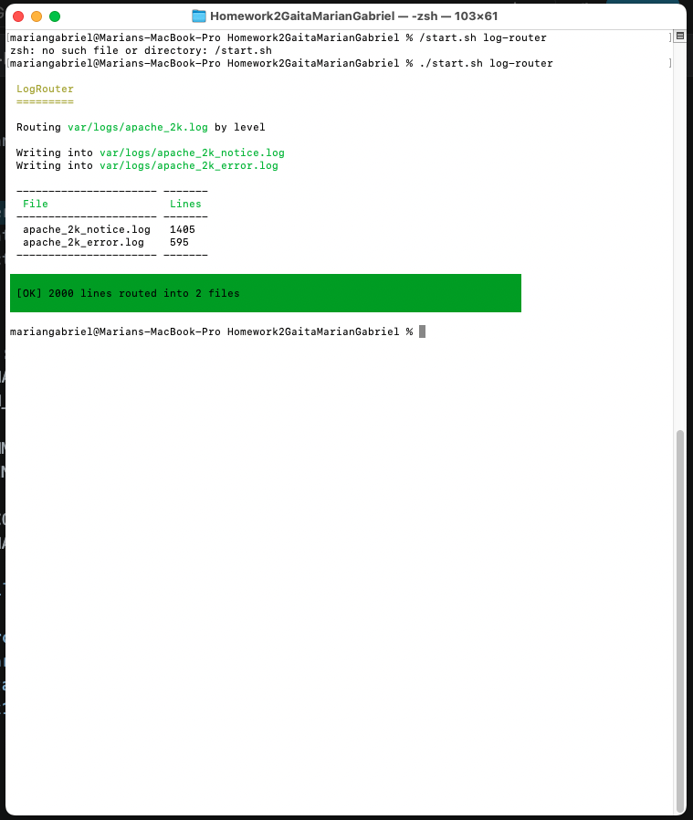
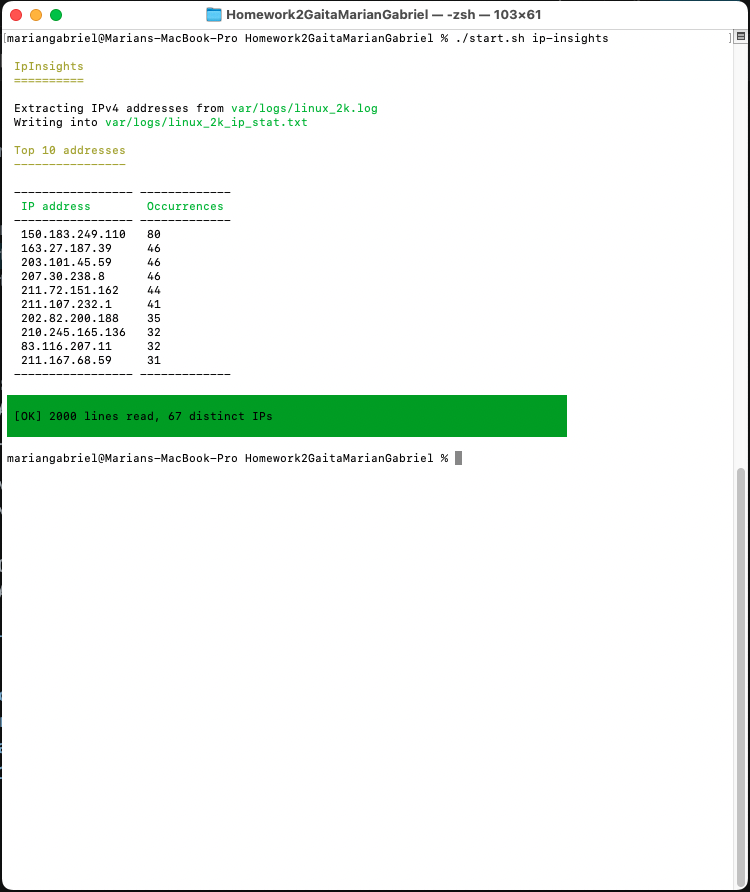
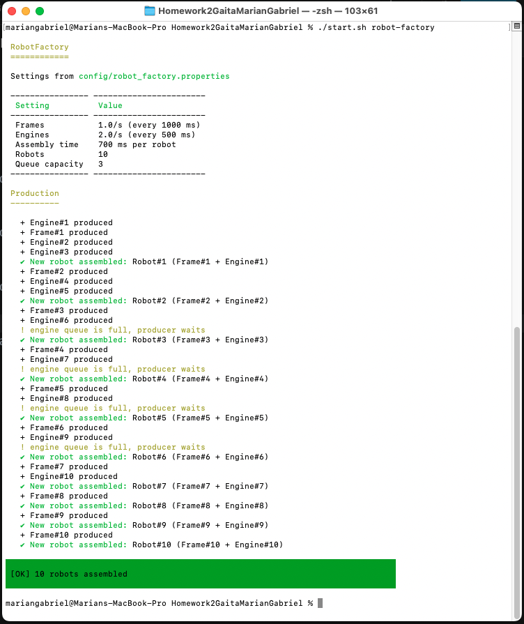
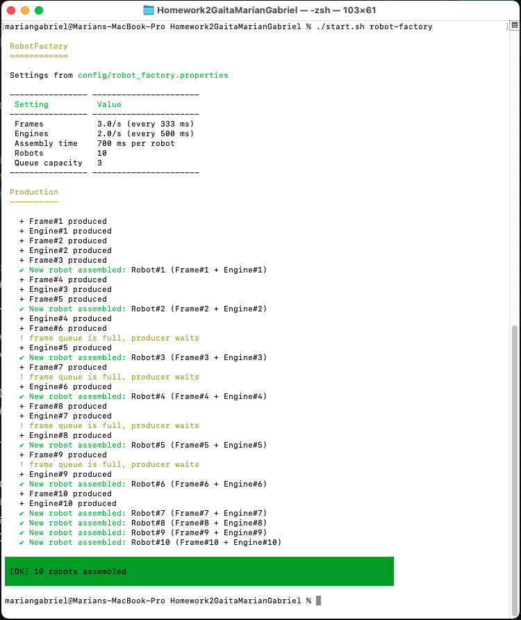

# Homework 2

Gaita Marian Gabriel

Three small Java programs, one for each homework problem.

## Requirements

Java 21 or newer.

## The problems

### 1. log-router

Reads `var/logs/apache_2k.log` line by line and writes each line into a separate file based on the label in the second column: `apache_2k_notice.log`, `apache_2k_error.log`, and additional files for any other labels it finds.

The generated filenames are lowercase, for example `apache_2k_notice.log` instead of `Apache_2k-[notice].log`.

Run:

```bash
./start.sh log-router
```

With a custom input file:

```bash
./start.sh log-router --log=var/logs/apache_2k.log
```

### 2. ip-insights

Extracts IPv4 addresses from `var/logs/linux_2k.log`, counts their occurrences, and writes the results to `var/logs/linux_2k_ip_stat.txt`, sorted from most frequent to least frequent.

Run:

```bash
./start.sh ip-insights
```

With custom input and output files:

```bash
./start.sh ip-insights --log=var/logs/linux_2k.log --stat=var/logs/linux_2k_ip_stat.txt
```

### 3. robot-factory

Starts three threads: one produces robot frames, one produces engines, and the third assembles robots using one frame and one engine. A message is printed for every completed robot.

Two queues with limited capacity connect the producers to the assembler, following the producer-consumer pattern.

Production rates, assembly time, robot count, and queue capacity are read from `config/robot_factory.properties`.

Run:

```bash
./start.sh robot-factory
```

With a custom configuration file:

```bash
./start.sh robot-factory --config=config/robot_factory.properties
```

## Run all programs

To run all three programs, one after the other:

```bash
./start.sh
```

The script compiles the sources into `target/classes` and then starts the selected program, or all three if no program is specified.

## Configuration (problem 3)

The configuration file is `config/robot_factory.properties`.

| Key | Meaning |
|---|---|
| `frame_rate_per_sec` | Number of frames produced per second |
| `engine_rate_per_sec` | Number of engines produced per second |
| `assembly_time_ms` | Time needed to assemble one robot, in milliseconds |
| `robot_count` | Total number of robots to build |
| `queue_capacity` | Maximum number of parts in each queue |

## Note

Yes, that suspiciously Symfony-like terminal styling? I asked my AI friend* to help with that. The rest of the code is mine, bugs included :)

## Screenshots

### log-router



### ip-insights



### robot-factory

Engines faster than frames (`frame_rate_per_sec=1`, `engine_rate_per_sec=2`), the engine queue fills up and the engine producer has to wait:



Frames faster than engines (`frame_rate_per_sec=3`, `engine_rate_per_sec=2`), now the frame queue is the one that fills up:


